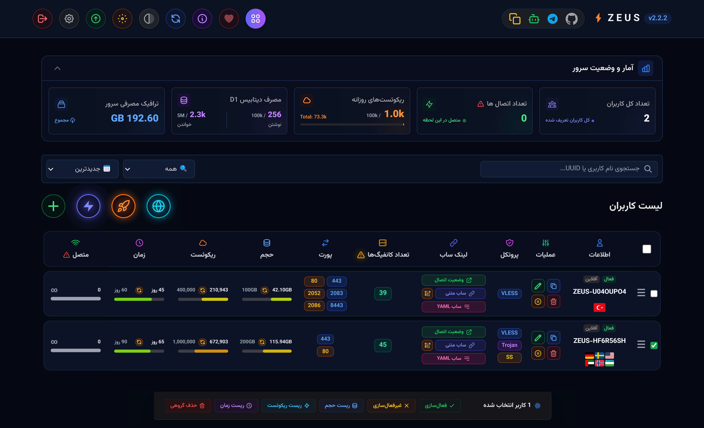
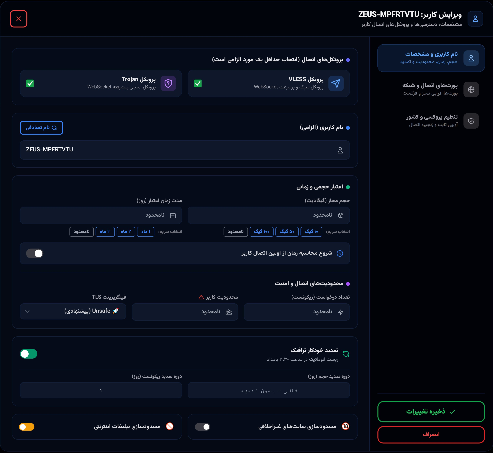
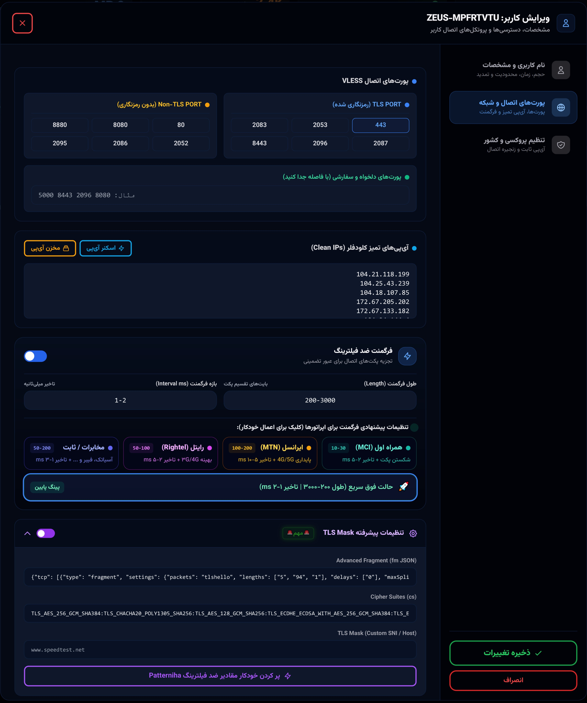
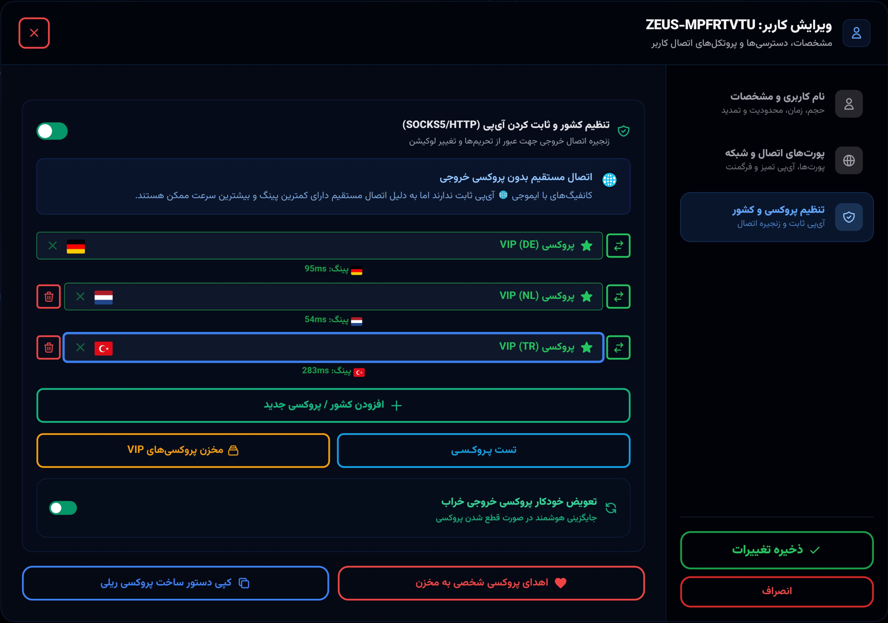

<div dir="rtl" align="right">

<p align="center">
  🇬🇧 <a href="README.md">English</a> &nbsp;|&nbsp;
  <a href="README.fa.md">فارسی</a> 🇮🇷 
</p>

<div align="center">
 
# ⚡ پنل زئوس
[](https://github.com/panel-zeus/Z-E-U-S)
[](https://workers.cloudflare.com/)
[-red.svg?style=for-the-badge)](https://github.com/panel-zeus/Z-E-U-S/blob/main/LICENSE)
[](https://t.me/PANEL_ZEUS)
</div>

<table width="100%">
<tr>
<td width="50%" valign="middle" align="center">

</td>
<td width="50%" valign="middle" align="center">

</td>
</tr>
<tr>
<td width="50%" valign="middle" align="center">

</td>
<td width="50%" valign="middle" align="center">

</td>
</tr>
</table>
 
<table width="100%">
<tr>
<td width="50%" valign="middle" align="center">

</td>
<td width="50%" valign="middle" align="center">

</td>
</tr>
</table>

<div align="center">

[⚡️ ویژگی‌های کلیدی](#features) • [🚀 راهنمای دیپلوی سریع](#-راهنمای-دیپلوی-سریع) • [🔎 اسکنر آی‌پی تمیز](#-اسکنر-آی‌پی-تمیز) • [🛡️ پروکسی SOCKS5](#️-ساخت-پروکسی-socks5-اختصاصی-zeus-relay) • [❤️ حمایت](#-حمایت-و-دونیت) • [⚖️ لایسنس و کپی‌رایت](#license-copyright) • [Credits](#credits-section)
</div>


> [!CAUTION]
> **هشدار امنیتی**
> اگر فکر می‌کنید این پروژه با دستورالعمل‌های جامعه یا سیاست‌های استفاده قابل قبول گیت‌هاب مطابقت ندارد، لطفاً به ما اطلاع دهید. ما تمام تلاش خود را می‌کنیم تا تمام پروژه‌هایمان امن و مطابق با سیاست‌های گیت‌هاب باشند.

---


## <a id="features"></a>⚡️ ویژگی‌ها و قابلیت‌ها

### 🚀 پروتکل‌ها و مسیریابی
* 📡 **پشتیبانی از ۳ پروتکل همزمان:** تولید همزمان یا مجزای کانفیگ‌های VLESS، Trojan و Shadowsocks (با v2ray-plugin و رمزنگاری `aes-256-gcm`).

* ✈️ **پروکسی وب اختصاصی تلگرام:** پیاده‌سازی کامل Telegram WebProxy روی ورکر کلودفلر (بدون نیاز به VPS)، همراه با سکرت سفارشی، مانیتورینگ مصرف و لینک مستقیم `t.me/webproxy`.

* 🌍 **تغییر ریجن و Smart Placement:** تنظیم منطقه خروجی ورکر کلودفلر (مناطق AWS اروپا، آمریکا، آسیا و...) و تغییر لوکیشن کانفیگ‌های مستقیم (🌐) بدون نیاز به پروکسی.

* 🚀 **ساخت آنی کانفیگ تک‌لوکیشن (راکت):** تست پینگ موازی تمام پروکسی‌های VIP کشور انتخابی و ساخت فوری سریع‌ترین کانفیگ تنها با یک کلیک.

* 🌐 **ساخت سریع کاربر (مستقیم و مولتی‌لوکیشن):** ایجاد فوری کاربر مستقیم یا چندلوکیشنی (اختصاص همزمان تا ۸ لوکیشن مجزا).

* 🔀 **جایگزینی خودکار پروکسی و چرخش IP:** تعویض خودکار پروکسی‌های خراب با نودهای سالم VIP و چرخش زمان‌بندی‌شده آی‌پی‌های تمیز کلودفلر برای اپراتورهای مختلف.

### 🛡 ضد فیلترینگ و دور زدن DPI
* 🔒 **پشتیبانی پیشرفته از ECH:** دور زدن سانسور با Encrypted Client Hello، پشتیبانی از رزولورهای UDP، TCP، DoH و تفکیک خودکار کانفیگ‌ها.

* 🧩 **تکه‌تکه‌سازی پیشرفته (TLS Fragment):** تنظیم دقیق طول و فاصله بسته‌ها برای عبور از بازرسی عمیق پکت‌ها (DPI).

* 🇮🇷 **پریست‌های آماده اپراتورها:** تنظیمات بهینه‌سازی اختصاصی و تک‌کلیکه برای همراه‌اول، ایرانسل، رایتل، مخابرات و حالت گیمینگ.

* 🎭 **یکپارچگی با Patterniha:** پشتیبانی کامل از JSON فرگمنت پیشرفته (`fm`)، سایفرهای سفارشی (`cs`) و ماسک‌گذاری TLS (Custom Host/SNI).

* 🕵️ **شبیه‌ساز اثرانگشت (ClientHello):** جعل امضای TLS مرورگرها (کروم، سافاری، iOS، اندروید و Edge) برای جلوگیری از شناسایی توسط فیلترینگ.

* 🧠 **دور زدن تحریم هوش مصنوعی و بلاکر هوشمند:** دسترسی روان به Gemini، ChatGPT و Claude به همراه مسدودسازی تبلیغات و محتوای NSFW از طریق DoH.

### 👥 مدیریت کاربران و سهمیه‌بندی
* ⚖️ **محدودیت‌های چندگانه:** اعمال دقیق محدودیت حجم (GB)، زمان اعتبار (روز)، سقف ریکوئست و تعداد دستگاه‌های همزمان (IP Limit).

* ⏳ **شروع از اولین اتصال:** محاسبه زمان انقضای اشتراک دقیقاً از لحظه برقراری نخستین اتصال کاربر.

* ♻️ **ریست خودکار سهمیه:** بازنشانی خودکار و زمان‌بندی‌شده حجم و ریکوئست‌ها در دوره‌های مشخص.

* 🛠 **عملیات گروهی و فیلتر پیشرفته:** فعال/غیرفعال‌سازی، حذف و ریست دسته‌ای، همراه با جستجوی سریع و فیلتر وضعیت کاربران.

* 🌐 **کنترل کانفیگ مستقیم:** امکان فعال یا غیرفعال‌سازی کانفیگ‌های بدون پروکسی به ازای هر کاربر.

### 📊 پایش سهمیه‌ها و ابزارهای تشخیصی
* 📉 **دیده‌بان مصرف ورکر کلودفلر:** ردیابی زنده درخواست‌های روزانه (سقف ۱۰۰k رایگان) و کل، همراه با نوار پیشرفت و هشدار عبور از سقف مجاز.

* 🗄 **مانیتورینگ سهمیه دیتابیس D1:** ردیابی سقف عملیات روزانه خواندن (۵M) و نوشتن (۱۰۰k) جهت جلوگیری از قطعی دیتابیس.

* ⚡ **تست پینگ زنده:** ابزار سنجش تأخیر اتصال از کاربر تا کلودفلر و از کلودفلر تا اینترنت جهانی.

* 🔍 **اسکنرهای داخلی:** اسکنر محلی آی‌پی تمیز (با دستورات یک‌خطی Pydroid و CMD) و اسکنر پروکسی‌های VIP.

* ⚠️ **هشدارهای هوشمند امنیتی:** تشخیص و هشدار اتصال حلقه‌ای (Loop)، راهنمای شمارنده آنلاین و فرمول تعداد کانفیگ‌ها.

* 🔄 **آپدیت آسان و بکاپ جامع:** بروزرسانی هسته پنل (OTA) بدون از دست رفتن اطلاعات به همراه خروجی/ورودی کامل دیتابیس D1.

### 📱 رابط کاربری مدرن AMOLED
* 🌙 **تم‌های چندگانه:** طراحی واکنش‌گرا با پشتیبانی از حالت دارک عمیق AMOLED، تم روشن و حالت Grayscale.

* 🌊 **موج‌های سه‌بعدی و سوئیچ GFX:** افکت بصری سه‌بعدی روان با قابلیت خاموش‌کردن گرافیک برای کاهش مصرف باتری در گوشی‌های ضعیف‌تر.

* 📲 **نرم‌افزار تحت وب (PWA):** قابلیت نصب سریع پنل روی اندروید، iOS، ویندوز و مک شبیه به اپلیکیشن بومی.

* 🔗 **پورتال‌های سلف‌سرویس:** ساخت خودکار لینک‌های ساب Base64، فرمت‌های YAML (کلش/سینگ‌باکس)، QR Code و هدر `Subscription-Userinfo`.

### 🤖 استقرار و اتوماسیون
* 🚀 **دیپلوی آسان با ربات تلگرام:** راه‌اندازی کامل دیتابیس D1 و پنل بدون نیاز به کدنویسی با ربات `@ZEUS_PANEL_BOT`.

* 🛡️ **رله اختصاصی زئوس (GOST):** اسکریپت شل یک‌خطی برای ساخت سریع پروکسی SOCKS5 اختصاصی روی سرورهای لینوکس (IPv4/IPv6).

* ☁️ **سازگاری با ورکر و پیجز:** طراحی بهینه‌شده طبق معماری سرورلس کلودفلر با استفاده از Connection Pooling و Queue Batching.


---

# 🚀 راهنمای دیپلوی سریع

<div align="center">

<a href="https://dash.cloudflare.com/" target="_blank">

</a>

<div align="center">
ابتدا وارد داشبورد کلودفلر خود شوید. مطمئن شوید از ایمیل تأییدشده استفاده می‌کنید، سپس روش دیپلوی زیر را دنبال کنید.
</div>

<br>

<a href="https://t.me/ZEUS_PANEL_BOT" target="_blank">

</a>

</div>

<br>

## 🤖 دیپلوی از طریق ربات تلگرام

1. 🌐 وارد **[ربات تلگرام زئوس](https://t.me/ZEUS_PANEL_BOT)** شوید و روی `Start` کلیک کنید.
2. 👤 از منوی اصلی روی **"➕ Register Cloudflare Account"** کلیک کنید.
3. 🔗 روی دکمه اینلاین **"🔑 Get Cloudflare Token"** کلیک کنید تا به اکانت کلودفلر خود هدایت شوید.
4. 🟦 به پایین صفحه کلودفلر اسکرول کنید، روی دکمه آبی `Continue to summary` کلیک کنید و سپس `Create Token` را بزنید.
5. 🔑 توکن تولیدشده را کپی کرده و **مستقیماً در چت ربات ارسال کنید**.
6. ⚡️ پس از تأیید توکن، به منوی اصلی برگردید، روی **"🚀 Build New Panel"** کلیک کنید و اکانت خود را انتخاب کنید. دیتابیس D1 و پنل شما به‌طور خودکار مستقر خواهد شد.

---

> [!CAUTION]
> **هشدار امنیتی حیاتی:** حتماً رمز عبور مدیریتی اولیه‌ای که در اولین ورود به پنل تنظیم می‌کنید را به‌صورت امن ذخیره کنید. آن را گم نکنید!

---


# 🛡️ ساخت پروکسی SOCKS5 اختصاصی (Zeus Relay)

یک اسکریپت bash اختصاصی برای استقرار فوری یک پروکسی SOCKS5 خصوصی و امن روی هر VPS لینوکسی (اوبونتو، دبیان، سنت‌او‌اس، راکی لینوکس) ارائه شده است. این کار به‌شدت برای کاربرانی که می‌خواهند پروکسی‌های مسکونی VIP برای مسیریابی ترافیک از طریق آی‌پی‌های تمیز و اختصاصی بسازند، توصیه می‌شود.

برای نصب، به‌روزرسانی یا حذف پروکسی GOST SOCKS5، دستور زیر را با دسترسی root روی سرور لینوکس خود اجرا کنید:

<div dir="ltr" align="left">

```bash
bash <(curl -Ls https://raw.githubusercontent.com/panel-zeus/Z-E-U-S/main/zeus-relay.sh | sed 's/\r$//')
```

</div>

این اسکریپت دارای منوی تعاملی، پیکربندی خودکار پورت، تولید تصادفی و امن نام کاربری/رمز عبور و پشتیبانی بومی از IPv4/IPv6 است.

---

# 🔎 اسکنر آی‌پی تمیز

پنل زئوس دارای یک اسکنر آی‌پی محلی بسیار بهینه‌شده و چندنخی است. می‌توانید سریع‌ترین و پایدارترین آی‌پی‌های تمیز کلودفلر را مستقیماً از دستگاه خود با روش‌های زیر پیدا کنید:

### 📱 کاربران موبایل (Pydroid 3 - اندروید)
1. اپلیکیشن **[Pydroid 3](https://play.google.com/store/apps/details?id=ru.iiec.pydroid3)** را از فروشگاه گوگل‌پلی نصب کنید.
2. اپ را باز کنید، از منوی کناری به **Terminal** بروید و دستور زیر را اجرا کنید:

<div dir="ltr" align="left">

```bash
python -c "import urllib.request; req = urllib.request.Request('https://raw.githubusercontent.com/panel-zeus/Z-E-U-S/refs/heads/main/zeus-scanner.txt', headers={'User-Agent': 'Mozilla/5.0'}); exec(urllib.request.urlopen(req).read().decode('utf-8').split('---PYTH' + 'ON---')[1].split('---POWERSHELL---')[0].strip())"
```

</div>

3. پس از راه‌اندازی سرور، آدرس `http://127.0.0.1:8000` را در مرورگر خود باز کنید.

### 💻 کاربران ویندوز (CMD / PowerShell)

**Command Prompt (CMD)** را در ویندوز باز کنید، دستور زیر را پیست کنید و Enter بزنید. رابط اسکنر پرسرعت به‌طور خودکار کامپایل و راه‌اندازی می‌شود:

<div dir="ltr" align="left">

```cmd
powershell -ExecutionPolicy Bypass -Command "[Net.ServicePointManager]::SecurityProtocol = [Net.SecurityProtocolType]::Tls12 -bor [Net.SecurityProtocolType]::Tls13; $wc = New-Object System.Net.WebClient; $wc.Encoding = [System.Text.Encoding]::UTF8; $text = ($wc.DownloadString('https://raw.githubusercontent.com/panel-zeus/Z-E-U-S/refs/heads/main/zeus-scanner.txt') -split '---POWERSHELL---')[1].Trim(); [IO.File]::WriteAllText('zeus-scanner.ps1', $text, [System.Text.Encoding]::UTF8); .\zeus-scanner.ps1"
```

</div>

---


# 💰 حمایت و دونیت

<div align="center">

<p>ساخته‌شده با ❤️</p>

<p><a href="https://donatonion.ir-netlify.workers.dev"><b>https://donatonion.ir-netlify.workers.dev</b></a></p>

<p>از حمایت شما برای زنده نگه‌داشتن و توسعه فعال این پروژه اوپن‌سورس سپاسگزاریم! 🙏</p>

</div>

---

## تاریخچه ستاره‌ها

<div align="center">

<a href="https://www.star-history.com/?repos=panel-zeus%2FZ-E-U-S&type=date&legend=bottom-right">
 <picture>
   <source media="(prefers-color-scheme: dark)" srcset="https://api.star-history.com/chart?repos=panel-zeus/Z-E-U-S&type=date&theme=dark&legend=bottom-right&sealed_token=r3Lb_3aKfu0utexFy3xJoisRGRSGS4OCoQg3ZS5TM1QCTppem2RU8sLiVsD6UQ38Ah92MwuZU_PjyQTFM5yY3rAw14WEjtonC70muFBH4RbXxBDGIy5iIw" />
   <source media="(prefers-color-scheme: light)" srcset="https://api.star-history.com/chart?repos=panel-zeus/Z-E-U-S&type=date&legend=bottom-right&sealed_token=r3Lb_3aKfu0utexFy3xJoisRGRSGS4OCoQg3ZS5TM1QCTppem2RU8sLiVsD6UQ38Ah92MwuZU_PjyQTFM5yY3rAw14WEjtonC70muFBH4RbXxBDGIy5iIw" />
   
 </picture>
</a>

</div>

---

## <a id="license-copyright"></a>⚖️ لایسنس و کپی‌رایت

**حق چاپ (c) ۲۰۲۶ مشارکت‌کنندگان پنل زئوس. تمامی حقوق محفوظ است.**

این نرم‌افزار فقط برای **استفاده شخصی و غیرتجاری** ارائه شده است. با دانلود یا استفاده از این نرم‌افزار، با شرایط سخت‌گیرانه زیر موافقت می‌کنید:

1. 🚫 **ممنوعیت فروش یا کسب درآمد:** حق فروش، اجاره یا اجاره دادن این نرم‌افزار و همچنین استفاده از آن برای ارائه خدمات تجاری (مثل فروش دسترسی به پنل یا کانفیگ) را ندارید.
2. 🚫 **ممنوعیت تغییر یا مشتق‌سازی:** تغییر، تطبیق، ترجمه یا ایجاد آثار مشتق بر اساس این سورس‌کد به‌شدت ممنوع است.
3. 🚫 **ممنوعیت توزیع مجدد:** حق میزبانی، انتشار یا توزیع مجدد این نرم‌افزار در هر مخزن، پلتفرم یا سرویس دیگری بدون اجازه کتبی صریح را ندارید.

سورس‌کد صرفاً برای شفافیت و دیپلوی شخصی منتشر شده است. برای شرایط کامل قانونی، لطفاً فایل [LICENSE](LICENSE) موجود در این مخزن را مطالعه کنید.

---

## <a id="credits-section"></a>بخش اعتبارات
این پنل در ابتدا توسط آراد و مورگان مفهوم‌سازی و نوشته شده است. نسخه فعلی نمایانگر یک تکرار گسترش‌یافته، بسیار بهینه‌شده و به‌شدت بازسازی‌شده از آن منطق اصلی است.

* **نویسندگان اصلی:** مفهوم پایه و چارچوب اولیه متعلق به [AG-Morgan](https://github.com/AG-Morgan) و [aradava](https://github.com/aradava) است.
* **نگهدارنده فعلی:** ارتقاهای سیستم، قابلیت‌های پیشرفته شبکه، بازطراحی رابط کاربری و زیرساخت دیپلوی خودکار توسط [PANEL_ZEUS](https://t.me/PANEL_ZEUS) توسعه و نگهداری شده است.

</div>
