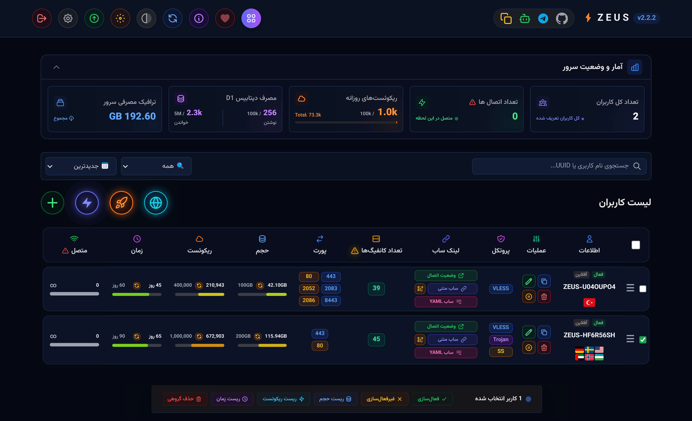
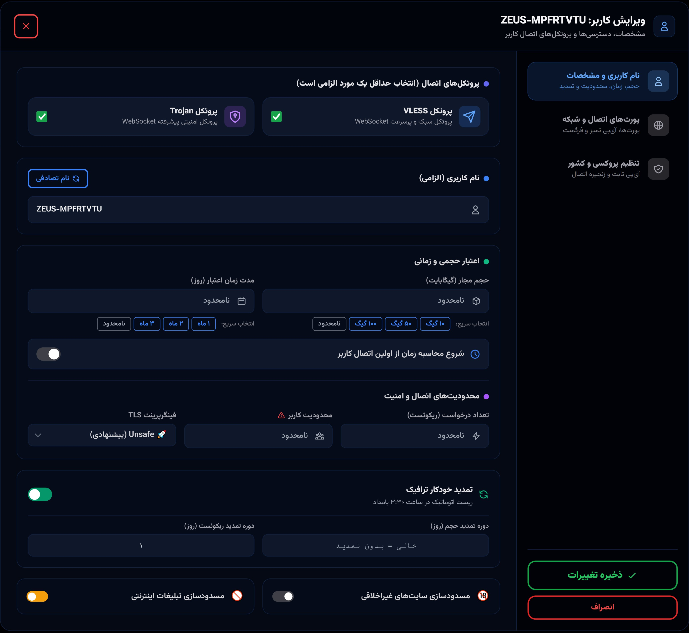
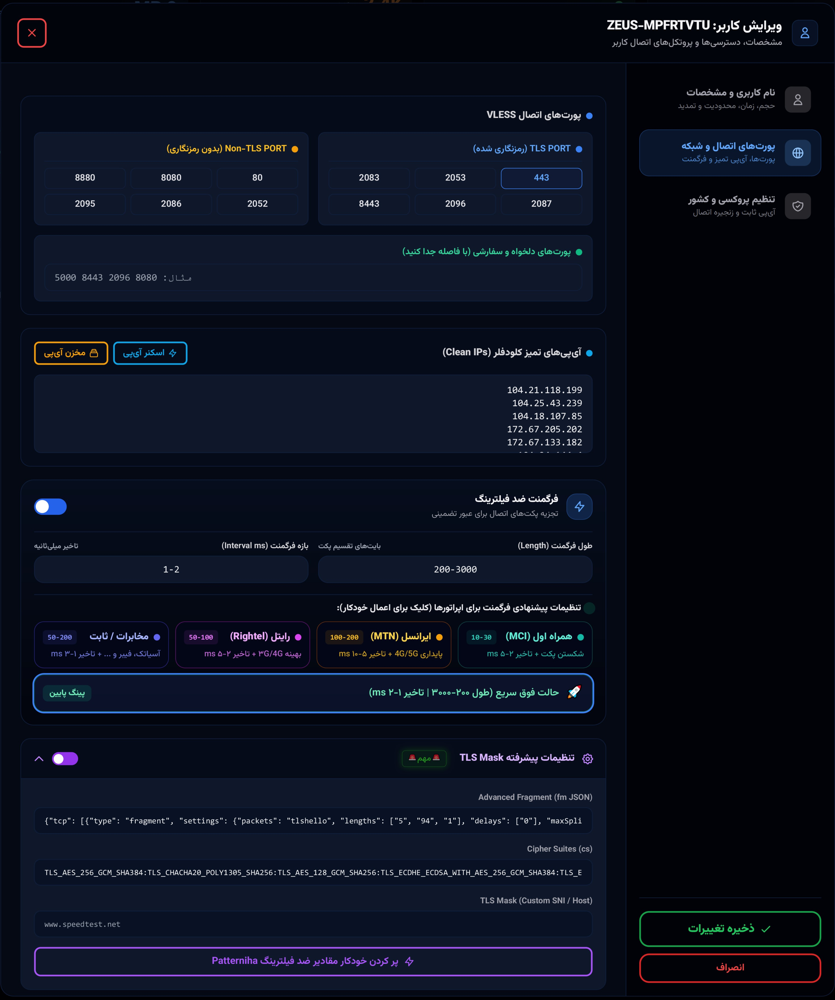
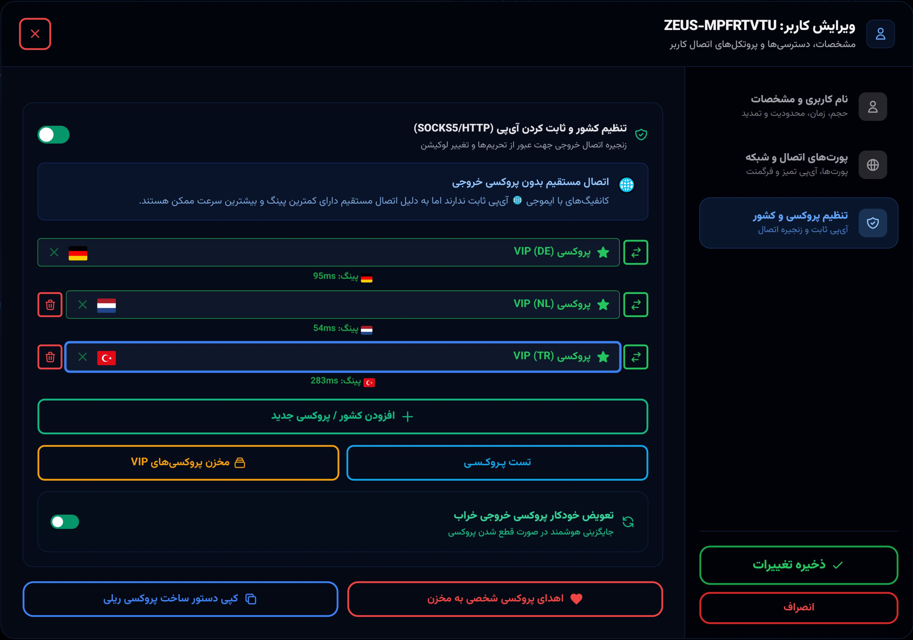

<p align="center">
  🇬🇧 <a href="README.md">English</a> &nbsp;|&nbsp;
  <a href="README.fa.md">فارسی</a> 🇮🇷 
</p>

<div align="center">
 
# ⚡ ZEUS PANEL
[](https://github.com/panel-zeus/Z-E-U-S)
[](https://workers.cloudflare.com/)
[-red.svg?style=for-the-badge)](https://github.com/panel-zeus/Z-E-U-S/blob/main/LICENSE)
[](https://t.me/PANEL_ZEUS)
</div>

<table width="100%">
<tr>
<td width="50%" valign="middle" align="center">

</td>
<td width="50%" valign="middle" align="center">

</td>
</tr>
<tr>
<td width="50%" valign="middle" align="center">

</td>
<td width="50%" valign="middle" align="center">

</td>
</tr>
</table>
 
<table width="100%">
<tr>
<td width="50%" valign="middle" align="center">

</td>
<td width="50%" valign="middle" align="center">

</td>
</tr>
</table>

<div align="center">

[⚡️ Key Features](#features) • [🚀 Deployment Guide](#-quick-deployment-guide) • [🔎 IP Scanner](#-clean-ip-scanner) • [🛡️ SOCKS5 Proxy](#️-build-your-own-socks5-proxy-zeus-relay) • [❤️ Donate](#-donate--support) • [⚖️ License & Copyright](#license-copyright) • [Credits](#credits-section)
</div>


> [!CAUTION]
> **Security Notice**
> If you believe this project does not comply with GitHub's Community Guidelines or Acceptable Use Policies, please let us know. We make every effort to ensure all our projects are secure and compliant with GitHub's policies.

---


## <a id="features"></a>⚡️ Features & Capabilities

### 🚀 Protocols & Core Routing
* 📡 **Triple-Protocol Engine:** Simultaneous or individual configuration generation for VLESS, Trojan, and Shadowsocks (with `v2ray-plugin` over WebSocket and `aes-256-gcm`).

* ✈️ **Cloudflare-Native Telegram WebProxy:** Zero-VPS serverless Telegram WebProxy running directly on Cloudflare Workers, featuring custom Secrets, live traffic (GB) and request tracking, active session counter, and direct `t.me/webproxy` connection links.

* 🌍 **Smart Placement & Region Switcher:** Adjust Cloudflare Worker egress regions (AWS US, Europe, Asia datacenters) to change the exit location of direct (🌐) configs without needing an external proxy.

* 🚀 **Rocket Single-Location Quick Creator:** Automated parallel ping benchmarking across all VIP proxies of a chosen country, instantly deploying the fastest node with a single click.

* 🌐 **Instant User Provisioning:** One-click quick creation for direct configs (with region capsule) and multi-location setups (up to 8 concurrent proxy locations).

* 🔀 **Auto Proxy Fallback & IP Rotation:** Automatic failover of unhealthy proxies to live VIP nodes, paired with scheduled Clean IP rotation for specific mobile operators.

### 🛡 Anti-Censorship & DPI Bypass
* 🔒 **Native Encrypted Client Hello (ECH):** Built-in ECH support with customizable domain pools, DNS IPs, and multi-protocol resolvers (UDP, TCP, DoH) with auto-labeled configs.

* 🧩 **Advanced TLS Fragmentation:** Fine-tuned packet length and interval controls to defeat Deep Packet Inspection (DPI).

* 🇮🇷 **ISP-Optimized Presets:** One-click fragmentation presets tailored for Iranian network operators (MCI, Irancell, Rightel, TCI, and low-latency Gaming mode).

* 🎭 **Patterniha Integration:** Full native support for advanced JSON fragmentation (`fm`), Custom Cipher Suites (`cs`), and TLS Masking (Custom SNI / Host).

* 🕵️ **ClientHello Fingerprint Simulator:** Spoofs TLS browser signatures (Chrome, Safari, iOS, Android, Edge) to blend into regular web traffic.

* 🧠 **AI Sanction Bypass & Content Blocker:** Direct routing to unblock restricted AI platforms (Gemini, ChatGPT, Claude), combined with DoH-based ad and NSFW/adult content blocking.

### 👥 User Management & Quota Enforcement
* ⚖️ **Granular Limits:** Enforce strict thresholds on Traffic Volume (GB), Time Expiration (Days), Total Requests, and Concurrent Devices (IP Limit).

* ⏳ **Start on First Connect:** Subscription duration countdown remains paused until the user's very first connection.

* ♻️ **Scheduled Quota Resets:** Automated periodic resets for volume and request counters based on user-defined day cycles.

* 🛠 **Bulk Actions & Smart Filtering:** Batch toggle, delete, and reset operations with instant search and status filtering (Active, Inactive, Online, Offline, Expired).

* 🌐 **Direct Config Control:** Toggle non-proxied (direct) configs on or off per individual user.

### 📊 Diagnostics & Quota Monitoring
* 📉 **CF Worker Quota Sentinel:** Real-time tracking of daily Worker requests against the 100k free tier limit with visual progress bars and proactive threshold alerts.

* 🗄 **D1 Database Daily Quota Guard:** Live monitoring of daily D1 writes (100k limit) and reads (5M limit) to prevent database lockouts.

* ⚡ **Live Ping Diagnostics:** Integrated tool measuring real-time latency from user to Cloudflare, and from Cloudflare to the global web.

* 🔍 **Built-in Scanners:** Multi-threaded local Clean IP scanner (with one-line Pydroid and CMD scripts) and VIP proxy repository scanner.

* ⚠️ **Intelligent Safety Warnings:** Modals alerting against loop connections (accessing panel through direct 🌐 config), online counter explanation, and config calculation formula.

* 🔄 **Zero-Downtime OTA Updates & Backup:** In-panel edge updates directly from the official repository without data loss, plus full JSON export/import for D1 database.

### 📱 Modern AMOLED UI/UX
* 🌙 **Multiple Themes:** Clean, mobile-first Tailwind CSS interface supporting AMOLED Dark Mode, Light Mode, and Grayscale mode.

* 🌊 **3D Interactive Waves & GFX Switch:** Smooth Three.js waves background with an in-panel toggle to disable animations for reduced battery and CPU usage.

* 📲 **Progressive Web App (PWA):** One-click installable app on iOS, Android, Windows, and macOS with native app feel.

* 🔗 **Self-Service Portals:** Automatic generation of Base64 subscriptions, YAML configs (Clash/Sing-box), QR codes, and user status pages with `Subscription-Userinfo` headers.

### 🤖 Deployment & Automation
* 🚀 **One-Click Telegram Bot Deployment:** Complete zero-coding setup of Workers, subdomains, and D1 database via `@ZEUS_PANEL_BOT`.

* 🛡️ **Zeus Relay (GOST SOCKS5):** Dedicated one-line bash script to deploy a private, authenticated SOCKS5 proxy on any Linux VPS (IPv4/IPv6).

* ☁️ **Workers & Pages Optimized:** Architected strictly within Cloudflare serverless limits using D1 connection pooling and queue batching.


---

# 🚀 Quick Deployment Guide

<div align="center">

<a href="https://dash.cloudflare.com/" target="_blank">

</a>

<div align="center">
First, log into your Cloudflare dashboard. Ensure you are using a verified email address, then proceed with the deployment method below.
</div>

<br>

<a href="https://t.me/ZEUS_PANEL_BOT" target="_blank">

</a>

</div>

<br>

## 🤖  Deploy via Telegram Bot 

1. 🌐 Access the **[ZEUS Telegram Bot](https://t.me/ZEUS_PANEL_BOT)** and click `Start`.
2. 👤 From the main menu, click on **"➕ Register Cloudflare Account"**.
3. 🔗 Click the inline button **"🔑 Get Cloudflare Token"** to be redirected to your Cloudflare account.
4. 🟦 Scroll to the bottom of the Cloudflare page, click the blue `Continue to summary` button, and then click `Create Token`.
5. 🔑 Copy the generated token and **send it directly in the bot chat**.
6. ⚡️ Once the token is verified, return to the main menu, click **"🚀 Build New Panel"**, and select your account. Your D1 database and panel will be automatically deployed.

---

> [!CAUTION]
> **CRITICAL SECURITY NOTE:** Ensure you securely save the initial administrative password you set during your first login to the panel. Do not lose it!

---


# 🛡️ Build Your Own SOCKS5 Proxy (Zeus Relay)

A dedicated bash script is provided to instantly deploy a private, secure SOCKS5 proxy on any Linux VPS (Ubuntu, Debian, CentOS, Rocky Linux). This is highly recommended for users who wish to create VIP residential proxies to route traffic through clean, dedicated IPs.

To install, update, or remove the GOST SOCKS5 proxy, execute the following command on your Linux server with root privileges:

```bash
bash <(curl -Ls https://raw.githubusercontent.com/panel-zeus/Z-E-U-S/main/zeus-relay.sh | sed 's/\r$//')
```

The script features an interactive menu, automatic port configuration, random secure credential generation (username/password), and native IPv4/IPv6 integration.

---

# 🔎 Clean IP Scanner

ZEUS Panel features a highly optimized, multi-threaded local IP scanner. You can quickly find the fastest and most stable clean Cloudflare IPs directly from your device using the methods below:

### 📱 Mobile Users (Pydroid 3 - Android)
1. Install **[Pydroid 3](https://play.google.com/store/apps/details?id=ru.iiec.pydroid3)** from the Google Play Store.
2. Open the app, navigate to the **Terminal** from the side menu, and execute the following command:

```bash
python -c "import urllib.request; req = urllib.request.Request('https://raw.githubusercontent.com/panel-zeus/Z-E-U-S/refs/heads/main/zeus-scanner.txt', headers={'User-Agent': 'Mozilla/5.0'}); exec(urllib.request.urlopen(req).read().decode('utf-8').split('---PYTH' + 'ON---')[1].split('---POWERSHELL---')[0].strip())"

```

3. Once the server initializes, open `http://127.0.0.1:8000` in your web browser.

### 💻 Windows Users (CMD / PowerShell)

Open **Command Prompt (CMD)** in Windows, paste the following command, and hit Enter. The high-speed scanner interface will automatically compile and launch:

```cmd
powershell -ExecutionPolicy Bypass -Command "[Net.ServicePointManager]::SecurityProtocol = [Net.SecurityProtocolType]::Tls12 -bor [Net.SecurityProtocolType]::Tls13; $wc = New-Object System.Net.WebClient; $wc.Encoding = [System.Text.Encoding]::UTF8; $text = ($wc.DownloadString('https://raw.githubusercontent.com/panel-zeus/Z-E-U-S/refs/heads/main/zeus-scanner.txt') -split '---POWERSHELL---')[1].Trim(); [IO.File]::WriteAllText('zeus-scanner.ps1', $text, [System.Text.Encoding]::UTF8); .\zeus-scanner.ps1"

```

---


# 💰 Donate & Support

<p align="center">Built with ❤️</p>

<p align="center"><a href="https://donatonion.ir-netlify.workers.dev"><b>https://donatonion.ir-netlify.workers.dev</b></a></p>

<p align="center">Thank you for your support in keeping this open-source project alive and actively developed! 🙏</p>

---

## Star History

<a href="https://www.star-history.com/?repos=panel-zeus%2FZ-E-U-S&type=date&legend=bottom-right">
 <picture>
   <source media="(prefers-color-scheme: dark)" srcset="https://api.star-history.com/chart?repos=panel-zeus/Z-E-U-S&type=date&theme=dark&legend=bottom-right&sealed_token=r3Lb_3aKfu0utexFy3xJoisRGRSGS4OCoQg3ZS5TM1QCTppem2RU8sLiVsD6UQ38Ah92MwuZU_PjyQTFM5yY3rAw14WEjtonC70muFBH4RbXxBDGIy5iIw" />
   <source media="(prefers-color-scheme: light)" srcset="https://api.star-history.com/chart?repos=panel-zeus/Z-E-U-S&type=date&legend=bottom-right&sealed_token=r3Lb_3aKfu0utexFy3xJoisRGRSGS4OCoQg3ZS5TM1QCTppem2RU8sLiVsD6UQ38Ah92MwuZU_PjyQTFM5yY3rAw14WEjtonC70muFBH4RbXxBDGIy5iIw" />
   
 </picture>
</a>

---

## <a id="license-copyright"></a>⚖️ License & Copyright

**Copyright (c) 2026 ZEUS PANEL Contributors. All Rights Reserved.**

This software is provided for **personal, non-commercial use only**. By downloading or using this software, you agree to the following strict conditions:

1. 🚫 **No Resale or Monetization:** You may not sell, rent, or lease this software, nor use it to provide commercial services (e.g., selling panel access or configurations).
2. 🚫 **No Modifications or Derivatives:** You are strictly prohibited from modifying, adapting, translating, or creating derivative works based on this source code.
3. 🚫 **No Redistribution:** You may not host, publish, or redistribute this software on any other repository, platform, or service without explicit written permission.

The source code is published solely for transparency and personal deployment. For the full legal terms, please read the [LICENSE](LICENSE) file included in this repository.

---

## <a id="credits-section"></a>Credits
This panel was originally conceptualized and authored by Arad and Morgan. The current version represents an extended, highly optimized, and heavily refactored iteration of that core logic.

* **Original Authors:** The baseline concept and initial framework belong to [AG-Morgan](https://github.com/AG-Morgan) and [aradava](https://github.com/aradava).
* **Current Maintainer:** The system upgrades, advanced network capabilities, UI redesign, and automated deployment infrastructure have been developed and maintained by [PANEL_ZEUS](https://t.me/PANEL_ZEUS).
